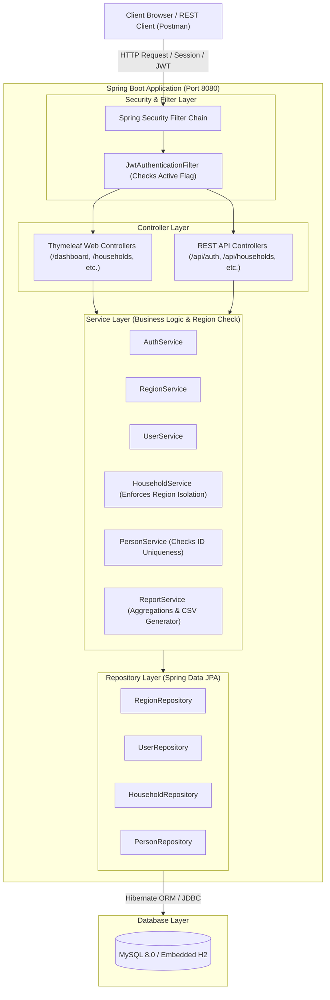
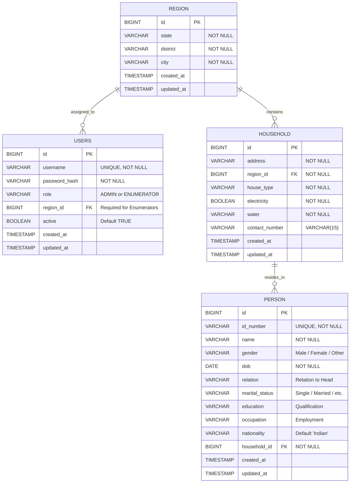
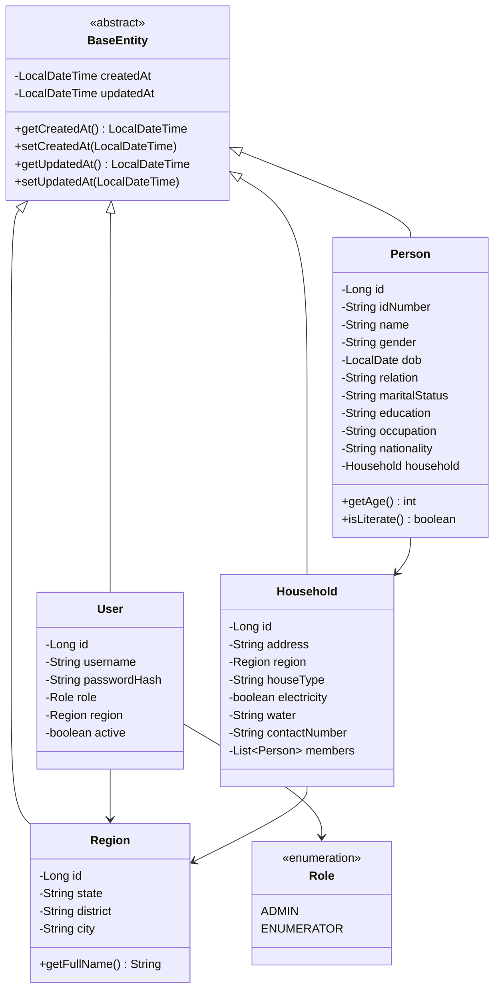
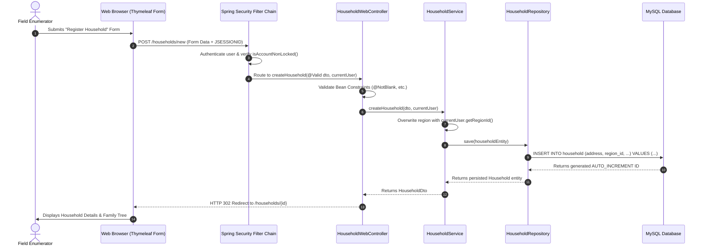

# National Census Management System (CMS)
## Academic Project Report & Technical Documentation

**Author / Team**: Academic Submission Team  
**Subject**: Advanced Java / Enterprise Application Development (Spring Boot)  
**Document Version**: 1.0.0  
**Submission Date**: November 2026  
**Live URL**: [https://census-management-system-5lpf.onrender.com](https://census-management-system-5lpf.onrender.com)  

---

## Table of Contents
1. [Abstract](#1-abstract)
2. [Introduction & Existing System Limitations](#2-introduction--existing-system-limitations)
3. [Proposed System Objectives & Scope](#3-proposed-system-objectives--scope)
4. [System Architecture & Layered Design](#4-system-architecture--layered-design)
5. [Database Design & Entity-Relationship Diagram](#5-database-design--entity-relationship-diagram)
6. [Class Diagram & OOP Modeling](#6-class-diagram--oop-modeling)
7. [Security Architecture & Regional Access Control](#7-security-architecture--regional-access-control)
8. [End-to-End Request Lifecycle (Viva Focus)](#8-end-to-end-request-lifecycle-viva-focus)
9. [REST API Specification](#9-rest-api-specification)
10. [Comprehensive Viva Voce Q&A Preparation](#10-comprehensive-viva-voce-qa-preparation)
11. [Conclusion & Future Scope](#11-conclusion--future-scope)

---

## 1. Abstract

The **Census Management System (CMS)** is an enterprise web application designed to automate, standardize, and accelerate nationwide census operations. Built entirely using modern **Java (Java 17+)**, **Spring Boot 3**, **Spring Security 6**, **Spring Data JPA (Hibernate 6)**, and **Thymeleaf**, the system replaces conventional paper-based demographic surveys with a centralized, real-time, tamper-resistant digital infrastructure.

The platform provides a dual-role access control hierarchy:
- **System Administrators**: Oversee geographic administrative regions (*State &rarr; District &rarr; City*), create and audit field enumerator credentials, monitor real-time population statistics (gender ratio, literacy rates, age group demographics), and export consolidated national census datasets in CSV format.
- **Field Enumerators**: Authenticate securely to collect dwelling infrastructure data (water source, electrification status, house type) and family member demographic details (National ID, gender, age, marital status, education, occupation).

Crucially, geographic isolation is enforced strictly at the Java backend service layer: field enumerators can only query and mutate census records belonging to their assigned jurisdiction, preventing unauthorized cross-regional data manipulation.

---

## 2. Introduction & Existing System Limitations

### 2.1 The Traditional / Legacy Census Model
Historically, national census operations in developing and transitional countries rely heavily on paper questionnaires filled out manually by enumerators during door-to-door visits. The filled forms are subsequently collected at local offices, physically transported to regional processing hubs, and manually keyed into legacy databases.

### 2.2 Limitations of the Existing System
1. **Prolonged Processing Lag**: The manual collection and digitizing cycle often spans 12 to 24 months before preliminary demographic reports can be published.
2. **High Error & Duplicate Rate**: Paper forms lack real-time validation, permitting duplicate national identification numbers, inconsistent age-to-date-of-birth entries, and illegible handwriting.
3. **Severe Vulnerability to Cross-Territory Data Tampering**: Field workers or supervisors cannot be strictly restricted to their designated boundaries, leading to overlapping household counts or uncounted neighborhoods.
4. **Enormous Logistics Overhead**: Printing millions of paper survey forms, managing physical secure storage, and hiring manual data-entry contractors entails massive public expenditure.
5. **No Real-Time Analytical Visibility**: Government planning bodies cannot observe real-time migration trends, gender distribution anomalies, or literacy deficits as data is collected.

---

## 3. Proposed System Objectives & Scope

### 3.1 Primary Objectives
- **100% Java-Centric Web Application**: Implement the entire application logic, data access, presentation, and authentication pipeline in Java to meet university and enterprise standards.
- **Strict Role-Based & Regional Security**: Guarantee that field enumerators cannot access or modify records outside their assigned territory, even if client URLs or payload parameters are forged.
- **Instant Demographic Analytics**: Compute gender ratios, literacy percentages, and age distribution cohorts (<18, 18-35, 36-60, 60+) on the fly using parameterized JPA queries.
- **Data Integrity & Duplicate Protection**: Implement database-level `UNIQUE` constraints and application-level exceptions (`DuplicateResourceException`) for citizen identification numbers and administrative region coordinates.
- **One-Click Data Portability**: Provide automated UTF-8 formatted CSV export functionality for integration with external governmental statistics tooling.

---

## 4. System Architecture & Layered Design

The application adheres strictly to the **Layered Software Architecture** pattern, enforcing separation of concerns between presentation, business rules, persistence, and database layers:

---

## 5. Database Design & Entity-Relationship Diagram

The database normalization reaches **Third Normal Form (3NF)**. A citizen's region is **never stored twice**; a person is linked directly to a `household`, and the household is linked to a `region`.

### Table Specifications & Constraints:
1. `region`:
   - Composite Unique Constraint: `UNIQUE(state, district, city)` prevents duplicate jurisdiction registrations.
2. `users`:
   - Unique Constraint: `UNIQUE(username)` prevents credential collision.
   - Foreign Key: `region_id -> region.id` is mandatory for enumerators and null for admins.
   - Boolean Flag: `active` enables instantaneous remote account locking.
3. `household`:
   - Foreign Key: `region_id -> region.id` guarantees every dwelling is anchored to a verified jurisdiction.
4. `person`:
   - Unique Constraint: `UNIQUE(id_number)` strictly prevents duplicate citizens nationwide.
   - Foreign Key: `household_id -> household.id` cascades member records on household changes.

---

## 6. Class Diagram & OOP Modeling

The project leverages key Object-Oriented Programming (OOP) paradigms:
- **Inheritance & Reusability**: All entities extend the abstract `BaseEntity` mapped superclass, which automatically manages `createdAt` and `updatedAt` audit timestamps using `@CreationTimestamp` and `@UpdateTimestamp`.
- **Encapsulation**: Private field access via standard Java getters and setters.
- **Polymorphism**: Spring Security's `UserDetails` implemented by `UserPrincipal`.

---

## 7. Security Architecture & Regional Access Control

### 7.1 Multi-Layer Defense in Depth
Security in the Census Management System is implemented following the principle of **Defense in Depth**:

1. **Password Hashing**: Passwords are never stored in plain text. Spring Security's `BCryptPasswordEncoder` computes a 60-character cryptographic salt and hash using 10 work rounds.
2. **Deactivation Check on Every Request**:
   - In both HTTP Session requests and REST API calls (JWT), `JwtAuthenticationFilter` or `CustomUserDetailsService` loads the live user record from the database.
   - If `user.isActive() == false`, authentication is instantly rejected, invalidating existing sessions and tokens.
3. **Region Boundary Enforcement in Java Service Layer**:
   - Field enumerators can only query and mutate households and persons inside their assigned region ID.
   - The region ID is read directly from the authenticated server-side `UserPrincipal`, **never** from client-supplied request parameters or form fields.
   - If an enumerator attempts to access `/households/99` or `/api/persons/45` belonging to another district, `HouseholdService.verifyRegionAccess()` throws a custom `RegionAccessDeniedException`, resulting in **HTTP 403 Forbidden**.

---

## 8. End-to-End Request Lifecycle (Viva Focus)

During project evaluation and viva examinations, examiners frequently ask:
> *"Trace a single request from the user interface down to the database and back."*

Below is the exact execution flow:

---

## 9. REST API Specification

| Endpoint | HTTP Method | Role Access | Description |
| :--- | :--- | :--- | :--- |
| `/api/auth/login` | `POST` | Public | Accepts JSON credentials; returns signed JWT token |
| `/api/regions` | `GET` | Admin | Returns paginated list or all regions (`?all=true`) |
| `/api/regions` | `POST` | Admin | Validates and creates a new region |
| `/api/regions/{id}` | `PUT` | Admin | Updates existing region details |
| `/api/regions/{id}` | `DELETE`| Admin | Deletes region (if no foreign keys violate) |
| `/api/admin/enumerators` | `GET` | Admin | Returns paginated list of field officers |
| `/api/admin/enumerators` | `POST`| Admin | Registers new enumerator linked to a region |
| `/api/admin/enumerators/{id}/status` | `PATCH` | Admin | Toggles enumerator active / deactivated flag |
| `/api/households` | `GET` | Admin / Enumerator | Returns households (filtered by assigned region for enumerators) |
| `/api/households` | `POST`| Admin / Enumerator | Registers new household in the authorized jurisdiction |
| `/api/households/{id}` | `GET` | Admin / Enumerator | Returns specific household details (with 403 region check) |
| `/api/persons` | `GET` | Admin / Enumerator | Searches citizens by name or National ID |
| `/api/persons` | `POST`| Admin / Enumerator | Adds new family member with duplicate ID validation |
| `/api/reports/summary` | `GET` | Admin | Calculates total population, gender ratio, literacy rate |
| `/api/reports/age-groups` | `GET` | Admin | Aggregates cohorts: <18, 18-35, 36-60, 60+ |
| `/api/reports/export` | `GET` | Admin | Generates and streams UTF-8 CSV report file |

---

## 10. Comprehensive Viva Voce Q&A Preparation

### Q1: Why did you choose Spring Boot over traditional Java Servlets / JSP?
**Answer**:
Spring Boot significantly boosts productivity by providing auto-configuration, an embedded Tomcat server, and opinionated starter dependencies (`spring-boot-starter-web`, `spring-boot-starter-data-jpa`, `spring-boot-starter-security`). Traditional Servlets and JSPs require extensive boilerplate code, manual web.xml configuration, and external servlet container deployment (WAR files). Spring Boot allows building production-ready, self-contained standalone JAR applications.

### Q2: How is cross-region security enforced in the application?
**Answer**:
Region security is enforced in the **Java Service Layer** (`HouseholdService` and `PersonService`), not in client-side code.
When an enumerator logs in, their assigned `region_id` is loaded from the database into the `UserPrincipal`.
Whenever an enumerator attempts to query, create, or update a household or citizen, the service method compares `household.getRegion().getId()` against `currentUser.getRegionId()`. If they do not match, a custom `RegionAccessDeniedException` is thrown, which translates into an **HTTP 403 Forbidden** response.

### Q3: How is password security implemented?
**Answer**:
Passwords are encrypted using the **BCrypt** algorithm via Spring Security's `BCryptPasswordEncoder`. BCrypt uses an adaptive cryptographic hashing function incorporating a random 128-bit salt and an exponential cost factor (default 10 rounds). This ensures passwords cannot be reverse-engineered via rainbow tables or brute-force dictionaries.

### Q4: How does the system prevent duplicate citizen registrations?
**Answer**:
Duplicate prevention is enforced at two distinct levels:
1. **Database Level**: The `person` table contains a unique constraint `CONSTRAINT uk_person_id_number UNIQUE (id_number)`.
2. **Service Level**: Before persisting a record, `PersonService` invokes `personRepository.existsByIdNumber(idNumber)`. If a duplicate is detected, it throws `DuplicateResourceException`, prompting the controller to display a clear, user-friendly error message to the field officer rather than an unhandled SQL error.

### Q5: What is the purpose of the `BaseEntity` class?
**Answer**:
`BaseEntity` is an abstract class annotated with `@MappedSuperclass`. It defines `createdAt` and `updatedAt` timestamp fields annotated with Hibernate's `@CreationTimestamp` and `@UpdateTimestamp`. Every entity (`Region`, `User`, `Household`, `Person`) extends `BaseEntity`, ensuring uniform audit logging across all tables without repeating boilerplate fields.

### Q6: How does the system reject deactivated accounts if a token or session is active?
**Answer**:
On every incoming HTTP request, the `JwtAuthenticationFilter` or `CustomUserDetailsService` queries the database for the user's latest state. If `user.isActive()` is false, the service throws a `DisabledException`, which immediately prevents authentication from completing, rendering obsolete tokens useless.

---

## 11. Conclusion & Future Scope

### 11.1 Conclusion
The **Census Management System** successfully delivers a robust, secure, and user-friendly digital platform built 100% in Java. It replaces prone-to-error paper procedures with an automated, layered architecture featuring strict role-based access control, regional boundary protection, interactive demographic analytics, and one-click data portability.

### 11.2 Future Scope (Post-Project Enhancements)
1. **Biometric Integration**: Support for fingerprint / iris hardware scanner APIs for identity verification.
2. **GIS & Geospatial Heatmaps**: Integration with OpenStreetMap or Google Maps APIs to visualize population density overlays.
3. **Offline Mobile Synchronization**: Progressive Web App (PWA) offline cache enabling field enumerators to gather survey data without active internet connectivity and synchronize upon reconnection.
4. **Cloud-Native Containerization**: Packaging the application into a Docker container for orchestration via Kubernetes on Google Cloud Platform (GCP) or AWS.
